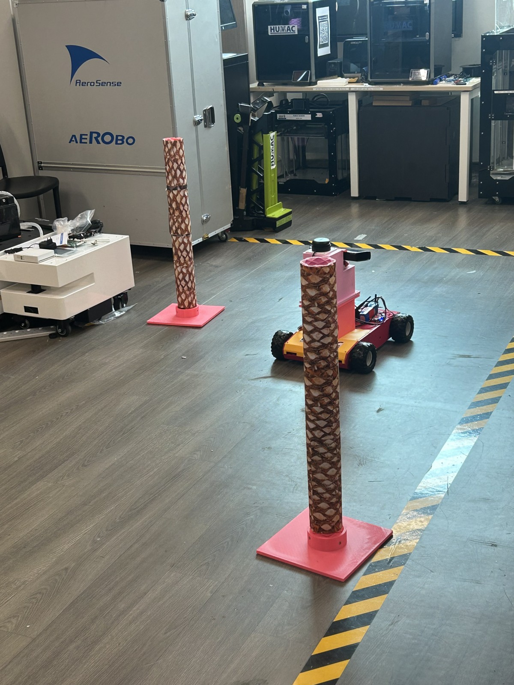
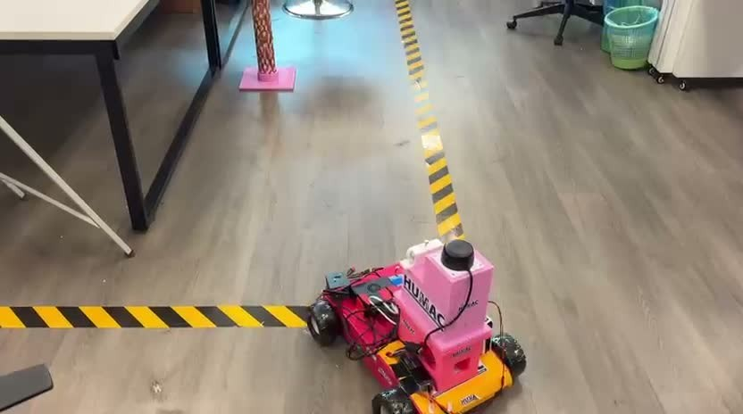
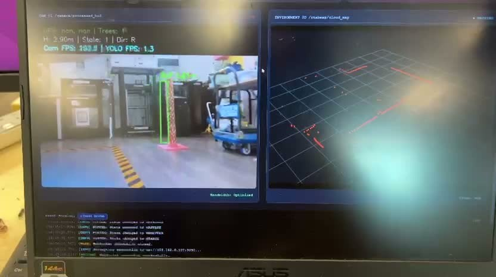
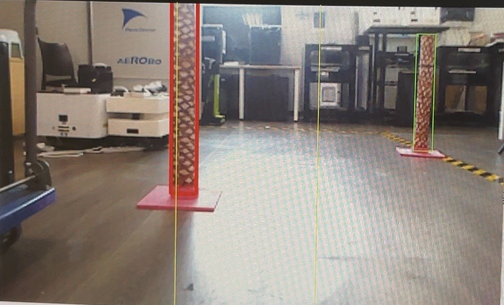

# Autonomous Harvesting Robot

**Visual navigation and RGB-D mapping for a laboratory palm-harvesting robot prototype.**

Developed by **Kemalgeldi Gurbannyyazov** · HUMAC

[Русская версия](README.ru.md)



## Overview

This project explores a perception-driven harvesting workflow: detect a mock palm trunk, steer toward it, stop for a timed harvesting phase and maneuver toward the next target. The integrated node also combines RGB-D measurements, TF2 transforms, GNSS input and a SQLite tree map.

The repository includes the most integrated controller snapshot, three earlier experiments, photographs and two silent demonstration videos. The recordings document laboratory trials and the operator interface; they are not a benchmark or evidence that every included code revision was running during recording.

**Status:** experimental research prototype. The control scripts preserve the original behavior. Known control and dashboard-integration defects are documented in [Code review](docs/CODE_REVIEW.md). They must be resolved and validated before operating hardware with this snapshot.

The current `HARVEST` state is a three-second dwell and counter increment. The included code does not command a physical cutting or harvesting actuator.

## Demonstrations

### Robot navigation

[](media/videos/robot-navigation.mp4)

[View/download navigation video — approximately 75 seconds, 10.4 MiB](media/videos/robot-navigation.mp4)

The robot moves through a laboratory course containing mock palm trunks.

### Operator interface and perception

[](media/videos/dashboard-perception.mp4)

[View/download dashboard and perception video — approximately 63 seconds, 8.7 MiB](media/videos/dashboard-perception.mp4)

The recording shows the operator console, a camera view with detection overlays and a map visualization. The web dashboard itself is a separate project and is not included here.

Videos are H.264 MP4 files with audio removed. The links point to repository files; inline playback in a GitHub README is not assumed. [Media details](docs/MEDIA.md)

### Detection example



## What the code contains

- YOLO inference for tree/trunk detection.
- Visual steering based on bounding-box center and apparent width.
- A mission state machine for searching, approaching, dwelling and maneuvering.
- RGB-D distance estimation and TF2 projection into the `map` frame.
- Persistent SQLite storage for mapped tree positions and GNSS samples.
- RViz marker publication and an OpenCV heads-up display.
- Mission-command and telemetry topics for integration with an operator dashboard.

These are implemented mechanisms, not claims of validated navigation accuracy or harvesting performance. Bounding-box width is used as an approach stopping threshold; there is no collision planner in the included scripts.

## Repository layout

```text
visual_servo/
  package.xml                   ROS package metadata and declared ROS dependencies
  CMakeLists.txt                Catkin packaging and Python node installation
  scripts/unified_mapper.py     Most integrated controller / mapper snapshot
experiments/
  tree_navig.py                 Earlier visual navigation controller
  unified_script.py             Earlier mapping + fixed-count mission experiment
  testing_nav_v2.py             Earlier image-callback navigation experiment
media/
  images/                       Metadata-free JPG photos and video previews
  videos/                       Silent H.264 demonstrations
  manifest.json                 Video sizes, durations and codec information
docs/
  CODE_REVIEW.md                 Confirmed defects and validation limits
  MEDIA.md                      Media descriptions and preparation details
  source-map.json               Original filenames and source checksums
requirements-reference.txt      Python dependency reference, not an environment lock
.github/workflows/              Source syntax and documentation checks
```

The four Python scripts are alternative development revisions. **Do not run them together:** each can publish velocity to `/cmd_vel`. See [Source map](docs/source-map.json) for their original names. Their contents have been preserved byte-for-byte; the main filename was normalized to `unified_mapper.py` for ROS tooling. Package metadata and build configuration were cleaned up separately.

## Environment and missing assets

The source targets a ROS 1 Python environment and was written for a Jetson-based robot. A macOS computer can browse the source and media, but is not the original robot runtime.

Required ROS components include `rospy`, `cv_bridge`, TF2, `sensor_msgs`, `geometry_msgs`, `std_msgs`, `vision_msgs` and `visualization_msgs`. Python inference also requires a compatible Ultralytics/PyTorch stack, NumPy and OpenCV.

The repository does **not** include:

- The custom YOLO model weights or training dataset.
- The original Jetson Python/CUDA environment or pinned dependency versions.
- Camera, motor-driver, localization, robot-description or map-to-camera TF configuration.
- A physical harvesting actuator driver, obstacle-avoidance stack or hardware safety controller.
- A complete robot bring-up launch file.

The main node currently expects weights at `/model_weights/best.pt` and a writable database directory at `/home/jetson/tree_database`. Earlier experiments use other hard-coded paths. These are machine configuration, not credentials. Make the paths configurable before deployment.

`requirements-reference.txt` is an inventory, not a tested installation recipe. Installing generic OpenCV/PyTorch wheels over a Jetson/ROS environment can break its existing binary dependencies. Reproduce the robot's compatible environment rather than treating this source snapshot as a one-command installation.

## ROS interface of the main snapshot

| Topic | Message | Direction / purpose |
| --- | --- | --- |
| `/camera/color/image_raw` | `sensor_msgs/Image` | Input RGB frames |
| `/camera/aligned_depth_to_color/image_raw` | `sensor_msgs/Image` | Input aligned 16-bit depth |
| `/fix` | `sensor_msgs/NavSatFix` | Input GNSS |
| `/start_mission` | `std_msgs/String` | Input mission requests |
| `/emergency_stop` | `std_msgs/String` | Input software stop/release requests |
| `/cmd_vel` | `geometry_msgs/Twist` | Output base velocity |
| `/yolo/detections` | `vision_msgs/Detection2DArray` | Output currently empty detection array; see review |
| `/harvest_markers` | `visualization_msgs/MarkerArray` | Output mapped tree markers |
| `/current_state` | `std_msgs/String` | Output state label |
| `/trees_done` | `std_msgs/Int32` | Output dwell-completion counter |
| `/fps` | `std_msgs/Float32` | Output HUD-loop frequency estimate |
| `/gps/fps` | `sensor_msgs/NavSatFix` | Output GNSS relay; name mismatch with dashboard |
| `/camera/processed_hud` | `sensor_msgs/Image` | Output annotated camera view |

### State labels

| State | Label |
| --- | --- |
| 0 | SEARCH |
| 1 | APPROACH |
| 2 | HARVEST |
| 3 | MANEUVER |
| 4 | MANUAL |
| 5 | STOPPED |
| 6 | PERMISSION |
| 7 | PAUSED |

The main node starts in `PERMISSION`. It accepts `START`, `PAUSE`, `RESUME` and `RESET`. The code does **not** currently handle `MANUAL_ON` or `MANUAL_OFF`, despite having a manual state. This snapshot is not directly interchangeable with a dashboard that sends those commands or subscribes to `/gps/fix`.

## Source checks

The included workflow checks Python syntax, package XML and local documentation links without importing ROS, loading a model or contacting hardware.

To run equivalent basic checks locally with Python 3:

```bash
python3 -m compileall -q visual_servo/scripts experiments
python3 -c "import xml.etree.ElementTree as ET; ET.parse('visual_servo/package.xml'); print('XML OK')"
```

Passing these checks does not establish correct ROS integration or safe robot behavior. [Code review](docs/CODE_REVIEW.md) records the control defects reproduced with isolated method calls. Full simulation, sensor-loss tests, motor-controller watchdog tests and supervised hardware validation remain necessary before operation.

## Safety boundary

This code sends movement commands to physical hardware. There is no independent command watchdog, collision detection or latched hardware emergency-stop implementation in the included source. Time-based reverse and forward maneuvers do not inspect obstacles.

Resolve the documented control defects and use a velocity arbiter, controller-side command timeout and independent physical emergency stop before testing on hardware. ROS topics and rosbridge must stay on a trusted network. Do not launch this snapshot on a powered robot as an unreviewed installation test.

## Upload to GitHub

Create a new **empty** repository named `humac-autonomous-harvesting-robot` under your GitHub account. Choose Public to make the project visible on your profile. Do not initialize another README, `.gitignore` or license on GitHub.

Open a terminal in this folder and run:

```bash
git init -b main
git add .
git status --short
git diff --cached --stat
git commit -m "Initial commit: autonomous harvesting robot"
```

Connect your new repository by replacing the final command's address with its HTTPS clone address. For the `kemalgeldi` account, this version constructs the URL from separate parts to avoid rich-text link formatting during copying:

```bash
git remote add origin "$(printf '%s' https :// github.com /kemalgeldi/ humac-autonomous-harvesting-robot.git)"
git push -u origin main
```

Both videos are below the normal GitHub per-file limit and do not require Git LFS. `.gitignore` excludes database files, model weights, ROS bags, local environments and generated workspace output. Keep those exclusions in place when adding later work.

If HTTPS asks for a password, use your GitHub access token or configured credential manager. A token used to upload `.github/workflows` also needs permission to write workflows. Do not place tokens in repository files or remote URLs.

GitHub source code and media hosting does not launch the robot or host its operator dashboard. The project does not currently specify a source-code license; the package metadata records that explicitly.
