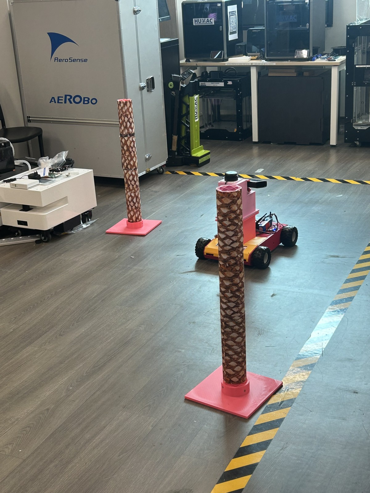
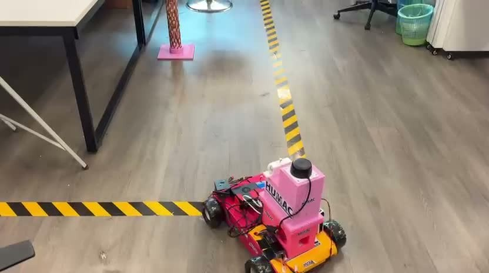
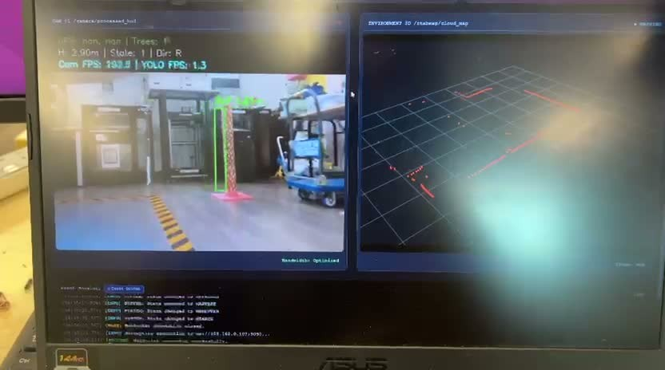

# Autonomous Harvesting Robot

Проект **Kemalgeldi Gurbannyyazov · HUMAC**: экспериментальная визуальная навигация робота к макетам пальмовых стволов, RGB-D-картирование и интеграция с панелью оператора.

[English README](README.md)



## Демонстрации

[](media/videos/robot-navigation.mp4)

[Посмотреть или скачать видео движения робота — около 75 секунд](media/videos/robot-navigation.mp4)

[](media/videos/dashboard-perception.mp4)

[Посмотреть или скачать видео панели и распознавания — около 63 секунд](media/videos/dashboard-perception.mp4)

В обоих роликах удалён звук. Из публикуемых фотографий удалены EXIF-метаданные, включая GPS. HEIC-фотография преобразована в JPG для совместимости.

Ролики показывают лабораторные испытания и интерфейс оператора. Это исторические записи, а не доказательство работы каждой версии кода из репозитория. Сама веб-панель хранится в отдельном проекте.

## Что находится в репозитории

- `visual_servo/scripts/unified_mapper.py` — наиболее интегрированная версия контроллера: YOLO, глубина, карта, SQLite и команды миссии.
- `experiments/` — три ранних эксперимента с навигацией и картированием.
- `visual_servo/package.xml` и `CMakeLists.txt` — описание ROS-пакета, его зависимостей и установки Python-ноды.
- `media/` — фото, превью и видео без звука.
- [CODE_REVIEW.md](docs/CODE_REVIEW.md) — подробный разбор обнаруженных ошибок и границ проверки.
- [source-map.json](docs/source-map.json) — соответствие оригинальных имён и контрольные суммы исходников.

Python-код сохранён без изменения алгоритмов. Основной файл переименован из `unified_script 2.0.py` в `unified_mapper.py`; остальные варианты отделены как эксперименты. Метаданные пакета и объявления зависимостей приведены в порядок отдельно.

## Оценка кода

Это содержательный исследовательский прототип: в нём соединены компьютерное зрение, движение, глубина, координаты, состояние миссии и база деревьев. Для портфолио полезно показывать код вместе с видео реальной лабораторной установки.

При этом найденные ошибки нужно исправить до запуска этой версии на роботе:

1. `MANUAL_ON` и `MANUAL_OFF` не обрабатываются, хотя такие команды отправляет dashboard. В состоянии MANUAL контроллер также продолжает публиковать нулевую скорость в `/cmd_vel`, мешая ручному управлению.
2. START не сбрасывает таймер поиска. После долгого ожидания запуск может сразу перейти в STOPPED.
3. PAUSE/RESUME учитывает время паузы как время манёвра или «сбора».
4. Программная аварийная остановка не имеет отдельной блокировки от последующего START.
5. GPS публикуется в `/gps/fps`, а панель ожидает `/gps/fix`.
6. Основной файл публикует пустой массив `/yolo/detections`.
7. Старые версии могут повторно использовать устаревший кадр либо молча переключаться на обычный YOLO вместо специальной модели.

Четыре проблемы — отсутствие команды ручного режима, конкурирующая нулевая скорость, устаревший таймер START и таймер PAUSE/RESUME — воспроизведены отдельными вызовами оригинальных методов с имитацией сообщений и времени. Это не тест настоящего робота.

Фаза HARVEST в этих файлах — ожидание трёх секунд и увеличение счётчика. Управления физическим режущим механизмом здесь нет.

## Среда выполнения

Проект относится к ROS 1 и исходной среде Jetson. В репозитории нет весов YOLO, обучающего датасета, точной версии окружения Jetson/CUDA, драйверов камеры и моторов, конфигурации TF/локализации и полной системы запуска робота.

Пути к модели и базе пока зашиты в коде. `requirements-reference.txt` перечисляет Python-зависимости, но не является проверенным установщиком или зафиксированным окружением. Настоящий запуск нужно готовить в совместимой среде ROS/Jetson после исправления замечаний.

Не запускай разные версии одновременно: они публикуют команды скорости в один `/cmd_vel`. До проверки на оборудовании нужны независимая физическая аварийная кнопка, тайм-аут команд на контроллере и единый источник/арбитр команд движения.

## Проверка исходников

Эти команды проверяют синтаксис и XML, не запускают ROS и не управляют роботом:

```bash
python3 -m compileall -q visual_servo/scripts experiments
python3 -c "import xml.etree.ElementTree as ET; ET.parse('visual_servo/package.xml'); print('XML OK')"
```

GitHub Actions выполняет такие же проверки синтаксиса и ссылок документации. Проверка реальной камеры, модели, ROS-связи, движения и физической остановки в подготовку репозитория не входила.

## Как загрузить на GitHub

Создай новый пустой репозиторий `humac-autonomous-harvesting-robot` в своём аккаунте. Для начала выбери Private. Не создавай на сайте ещё один README, `.gitignore` или лицензию.

В Terminal перейди в подготовленную папку проекта и выполни команды по очереди:

```bash
git init -b main
git add .
git status --short
git diff --cached --stat
git commit -m "Initial commit: autonomous harvesting robot"
```

Для аккаунта `kemalgeldi` подключи репозиторий и отправь код:

```bash
git remote add origin "$(printf '%s' https :// github.com /kemalgeldi/ humac-autonomous-harvesting-robot.git)"
git push -u origin main
```

Адрес собирается из частей, чтобы при копировании не превращаться в оформленную ссылку. Если репозиторий назван иначе, замени его имя в команде.

Если GitHub снова выдаёт 403 из-за сохранённого доступа, используй корректный токен с доступом к новому репозиторию. Токен, созданный только для `humac-robot-dashboard`, сам по себе не даёт доступ к этому новому проекту: нужно добавить новый репозиторий в его разрешения или создать отдельный токен. Нужны права Contents и Workflows на запись.

Фото и видео уже включены в подготовленную папку. Размер каждого файла меньше обычного лимита GitHub, поэтому Git LFS здесь не требуется. `.gitignore` исключает базы, модели, ROS-записи, временные файлы и локальные настройки.

Исходная папка проекта остаётся отдельно. В ней могут быть оригинальные HEIC, звук и метаданные: для публикации используй именно подготовленную версию.
